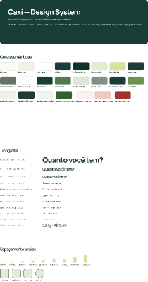

# Caxi — fonte de design

[Exportação Figma original](caxi-design-system.fig), recebida em 26/10/2026. O arquivo permite inspecionar o design system localmente, independentemente da permissão do link remoto.

## Conteúdo conferido

- Três páginas: **00 · Capa e Fundamentos**, **01 · Componentes** e **02 · Telas de referência**.
- 57 variáveis nas coleções **Primitives**, **Semantic** e **Dimensions**.
- 11 estilos de texto: Manrope nos títulos e DM Sans nos textos e controles.
- 47 componentes/variantes, incluindo ícones, Button, Field, Notice, QuantityControl, ChoiceOption/ChoiceGroup e StepIndicator/StepProgress.
- A página **Telas de referência está vazia** nesta exportação. O arquivo documenta o design system; não contém as jornadas completas do aplicativo.

O [inventário extraído](inventory.json) registra IDs, valores, fontes, dimensões e a comparação com os tokens CSS de `apps/web/src/enzo/styles/tokens.css`. Não contém contas, sessões ou dados da operação da barraca.

## Comparação com o código incorporado

55 dos 57 valores de variáveis coincidem com o código de Enzo. As duas diferenças são:

| Token | Exportação Figma | Código React/CSS |
|---|---|---|
| radius/md | 12 px | 14 px |
| radius/lg | 16 px | 20 px |

Os controles de toque têm os mesmos valores (48 e 60 px), com nomes CSS diferentes: o arquivo indica `--touch-min`/`--touch-main`, enquanto o código usa `--size-touch-min`/`--size-touch-main`.

A conferência valida o conteúdo estrutural e os valores extraídos. Não substitui uma comparação visual de cada variante renderizada. A interface entregue por Rafael/Maria continua preservada; nenhuma jornada foi redesenhada a partir desta inspeção.

O link remoto continua sujeito às permissões do conector. Esta exportação passa a ser a fonte local versionada para revisão e evolução do design system.
