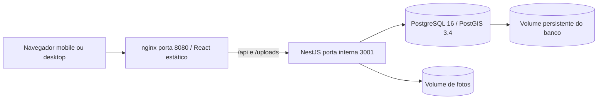
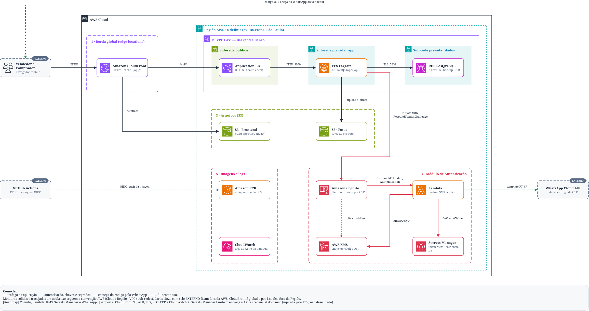
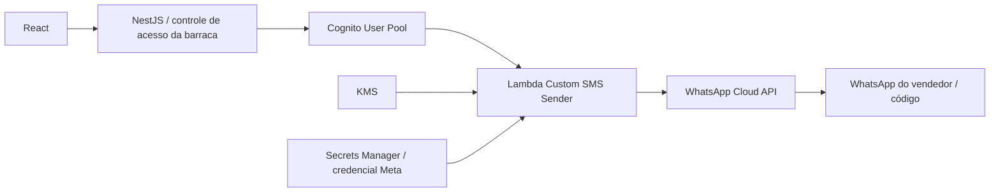
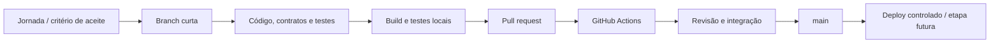

# Secure DevOps Tools & Cloud Computing

## Materiais de arquitetura entregues por Enzo

- [Documento explicativo original em PDF](../arquitetura/enzo/como-funciona-a-arquitetura.pdf).
- [Diagrama original em PNG](../arquitetura/enzo/caxi-arquitetura.png).
- [Fonte editável recuperada do PNG, em draw.io](../arquitetura/enzo/caxi-arquitetura.drawio).

O [índice dos materiais](../arquitetura/enzo/README.md) relaciona o plano AWS à implementação consolidada e identifica diferenças de configuração. Os arquivos originais estão preservados como parte da entrega de DevOps.

## Mapa do ambiente de demonstração



`compose.yaml` descreve esse ambiente. Só o frontend é publicado em `127.0.0.1:8080`; PostgreSQL fica acessível no host apenas por loopback para desenvolvimento. A API não tem porta publicada pelo Compose. Readiness depende do banco; o frontend espera API saudável. Migrations são aplicadas na inicialização.

Alternativa sem Docker: Vite em `127.0.0.1:5173` encaminha `/api` e `/uploads` para NestJS em `127.0.0.1:3001`; o banco local é SQLite/SQL.js. Dados e fotos ficam fora do controle de versão.

## Proposta cloud



[Explicação completa da arquitetura](../arquitetura/enzo/como-funciona-a-arquitetura.pdf) · [Abrir fonte editável](../arquitetura/enzo/caxi-arquitetura.drawio). O [SVG anteriormente recebido](../arquitetura/aws-proposta-enzo.svg) permanece como referência.

Esse desenho é uma proposta de infraestrutura, não evidência de recursos implantados. A base de provisionamento de identidade está em `infrastructure/main.tf` e `infrastructure/whatsapp-sender/`.



A configuração Cognito depende da conta AWS, IAM, conta/número/template da Meta e do plano de autenticação. O caminho real não é declarado como validado nesta entrega local. O vendedor não precisa conectar sua conta pessoal à API de mensagens para receber pedidos pelo link.

## Ambientes

| Ambiente | Configuração | Finalidade |
|---|---|---|
| Local Node | Demo, SQLite/SQL.js e fotos locais | Desenvolvimento rápido e apresentação sem dependência AWS |
| Local Compose | Demo, PostgreSQL/PostGIS e volumes | Reprodução do ambiente integrado e teste de persistência relacional |
| CI | Banco e dados descartáveis | Build, testes e reprodução do Compose |
| Produção proposta | Cognito, HTTPS, PostgreSQL, gestão de segredos e armazenamento persistente | Piloto real após configurar e validar os serviços externos |

## Processo de desenvolvimento e pipeline



O workflow `.github/workflows/ci.yml` roda em pushes na main e PRs:

| Job | Verificações |
|---|---|
| qualidade | Instalação com lockfile, build, testes de domínio/HTTP e auditoria de dependências de produção |
| postgres | Aplicação inicial das migrations e testes HTTP contra PostGIS |
| ambiente-reproduzivel | Build das imagens, inicialização/saúde do Compose e smoke test da jornada via nginx |

O pipeline é de **CI**. Não há promoção automática à AWS nem comprovação de CD/deploy. A execução inicial da consolidação cria a base do repositório; mudanças seguintes devem usar branches e PRs. Proteção da main e revisão obrigatória dependem de configuração do repositório e não são presumidas por existir um workflow.

## Segurança e operação

- Sessão em cookie HttpOnly; Secure em produção e SameSite=Lax. Mutações autenticadas conferem X-CSRF-Token; origem é verificada quando fornecida pelo navegador.
- Autorização de produtos e pedidos pelo proprietário. Catálogo não expõe sessão, endereço de comprador nem estoque exato.
- Limite de requisições, tentativas de código e tamanho/tipo do upload. Credenciais da Meta ficam fora do frontend.
- Em produção, a aplicação rejeita modo demo e configuração incompleta. Exigir HTTPS e segredos em serviço apropriado/role de execução.
- Credenciais do Compose são locais e devem ser substituídas antes de qualquer publicação externa.
- `GET /api/health/live` verifica processo. `GET /api/health/ready` verifica conectividade com banco. Logs são de aplicação; não há observabilidade cloud implantada comprovada.
- Alterações de produto usam versão; edições antigas retornam 409. Pedidos e estoque usam transação e bloqueio compartilhado por barraca; PostgreSQL usa advisory lock transacional.

## Backup, recuperação e rollback

Para o ambiente local, preservar os volumes e não executar `docker compose down -v` quando houver dados a manter. Exemplo de backup:

```bash
docker compose exec -T postgres pg_dump -U caxi caxi > caxi-backup.sql
docker compose cp api:/app/apps/api/uploads ./backup-fotos
```

Guardar cópias em local protegido, fora do Git. Restauração deve ocorrer em ambiente separado antes de substituir o banco ativo. O exemplo não é evidência de restauração executada.

Para rollback de código, usar a imagem/commit anterior após verificar compatibilidade do schema. Mudanças destrutivas de banco exigem backup e plano específico; não reverter migrations cegamente. Infraestrutura real, alarmes e exercícios de recuperação são passos para o piloto.
