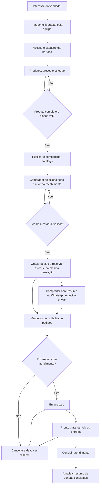

# Robotic Process Automation — Processo mapeado

## Processo atual de referência

O processo de referência representa a operação que o Caxi pretende organizar: vendedor divulga fotos e preços pelo WhatsApp, comprador escreve a encomenda, vendedor interpreta e transcreve itens, confere disponibilidade, calcula o total e combina pagamento e atendimento. A preparação exige reunir informações de conversas e anotações. É um modelo do problema, sem afirmar observação de campo adicional nesta consolidação.

## Processo com Caxi

| Etapa | Responsável operacional | Entrada | Saída | Exceção / tratamento | Candidato à automação |
|---|---|---|---|---|---|
| Manifestar interesse | Vendedor | Nome e WhatsApp | Interesse registrado | Telefone inválido; orientar correção | Deduplicação e registro do interesse |
| Liberar acesso | Equipe Caxi | Interesse e triagem | Acesso aprovado | Ainda pendente; informar espera | Notificação de convite e acompanhamento da triagem |
| Entrar | Vendedor e serviço de identidade | Telefone, desafio e código | Sessão | Código incorreto/expirado, limite ou falha no envio | Verificação e renovação da sessão |
| Manter barraca e produtos | Vendedor | Nome, foto, unidade, preço e estoque | Oferta salva | Dados inválidos, falha de upload ou edição antiga | Validação e preservação do rascunho |
| Publicar | Vendedor e Caxi | Produto completo e disponível | Catálogo público | Sem produto publicável; bloquear com orientação | Verificação dos critérios de publicação |
| Divulgar | Vendedor | Link público | Catálogo chega à base de contatos | Falha ao compartilhar; copiar link | Preparação do link e mensagem; envio manual |
| Comprar | Comprador | Itens, quantidades, contato e retirada/entrega | Solicitação de pedido | Endereço ausente na entrega; solicitar preenchimento | Cálculo e validação do resumo |
| Registrar e reservar | Caxi | Pedido válido e estoque | Pedido recebido e saldo reservado | Estoque insuficiente; rejeitar sem gravação parcial | Transação e prevenção de duplicatas |
| Conversar | Comprador e vendedor | Resumo e referência do pedido | Condições combinadas | Abrir WhatsApp não prova envio | Mensagem preenchida; negociação permanece humana |
| Preparar | Vendedor | Pedido recebido | Pedido em preparo/pronto | Cancelar enquanto não concluído | Fila e mudança de status |
| Retirar/entregar | Vendedor e comprador | Pedido pronto e combinado | Atendimento concluído | Problema no atendimento; tratar manualmente | Registro de conclusão; logística permanece do vendedor |
| Cancelar | Vendedor e Caxi | Pedido não concluído | Pedido cancelado e saldo reposto | Concluído não pode cancelar; impedir transição | Reposição uma única vez |
| Consultar resultados | Vendedor | Pedidos e produtos persistidos | Totais de concluídos e estoque | Sem dados; mostrar estado vazio | Agregação de valores e contagens |

## Regras e fronteiras

- Um responsável por cada ação é o ator operacional da tabela; atribuição nominal de desenvolvimento não altera o processo.
- Por kg, o passo de compra é 0,5; por unidade, inteiro. O backend calcula o total em centavos, arredondando cada subtotal ao centavo mais próximo.
- Reserva ocorre na criação do pedido. Pagamento e entrega física não são confirmados automaticamente.
- A criação/reserva e o cancelamento/reposição são transacionais. Um identificador repetido com o mesmo conteúdo retorna o mesmo pedido; com outro conteúdo, gera conflito.
- O requisito específico desta sprint é **processo mapeado**, incluindo candidatos à automação. Não se acrescenta robô obrigatório ao escopo de hoje.
